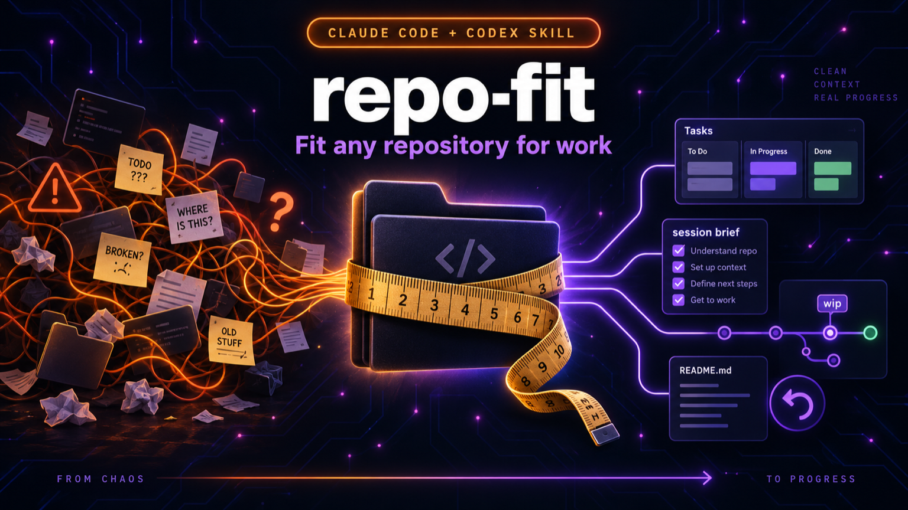

<p align="center">
  
</p>

# repo-fit

[](https://github.com/JimmySadek/repo-fit/actions/workflows/test.yml) [](CHANGELOG.md) [](https://www.npmjs.com/package/repo-fit) [](LICENSE)

**From chaos to progress.**

Every new AI chat starts from zero. Meanwhile, your project folder fills up with loose screenshots, PDFs, `notes-final-v2.md`, and folders named `old` or `New Folder`. You spend the start of every session hunting for files and re-explaining where things live.

**repo-fit** organizes your project folder so you and your AI assistant can find anything in two steps, then keeps it organized. It works on a brand-new project and on a folder that grew for years. You see the before and after first. Nothing moves without your yes, nothing is deleted during organizing, and one command undoes it all.

It uses plain files and folders only. There is no database, no search server, and no cloud upload. It is built for **Claude Code** and **Codex**, and because everything is plain Markdown (`MAP.md`, index pages, and `AGENTS.md`), other assistants such as Gemini or Cursor can navigate the same map right away.

## See what happens before you say yes

Here is the actual preview `repo-fit` shows on a messy sample folder (`spaghetti`) with 32 loose files, two old folders, a duplicate note, and a small website inside it. Nothing has changed yet:

```text
Your folder today                             After one yes (undo any time)
32 things loose at the top                    MAP.md: start here, it says what lives where
  12 images and screenshots                   notes/: your 12 notes
  5 documents (PDFs and similar)              media/: your 11 images
  14 notes                                    documents/: your 5 documents
  1 data file                                 inbox/: new things land here (1 waiting now)
Old-looking folders: "old/", "New Folder/"    archive/: "old/", "New Folder/", 1 copy, dated 2026-10-05. Nothing deleted
1 exact copy of another file                  website/: the program stays exactly where it is
website/ (a program)
```

Along with that screen, repo-fit tells you in plain words why it helps:
- **14 loose notes** get sorted: 12 move into `notes/` (with groups of 3 or more matching files, such as `japan-trip-*` or `client-acme-*`, put in their own subfolders), 1 exact copy goes to `archive/`, and 1 empty note waits in `inbox/`.
- **4 links inside your notes** update automatically so none of them break.
- **Code and files your code uses** (`website/`, `logo.png`, `prices-2026.csv`) stay right where they are.
- **Your own folder names come first.** If you already have `photos/` or `pdfs/`, repo-fit reuses them instead of making new ones.

## Is this for you?

- You are a **founder, product manager, designer, marketer, writer, or consultant** using an AI assistant to think, write, and plan.
- You keep **notes, research, and decisions** in a folder and are tired of re-explaining everything at the start of every session.
- You have a **folder that grew without structure** (photos, PDFs, notes, maybe some code) and want it sorted after seeing the before and after.
- You switch between **Claude Code and Codex** (or other AI tools) and want them to follow the same rules and start from the same map.

You do not need to be a developer. You need an AI assistant, [Node.js](https://nodejs.org) (version 18 or newer, free), and about 10 minutes.

**It is not** a search engine, a database, or a replacement for your assistant. It gives you both a tidy folder to work in.

## Start in 2 minutes

Open your project folder in **Claude Code** or **Codex** and paste this:

```text
Install the repo-fit skill with `npx skills add JimmySadek/repo-fit -g -a claude-code codex -y`, then use it to organize this project. Before you change anything, show me the before and after and explain it in plain words.
```

Here is what happens next:

```text
1. LOOK              2. SEE                      3. CHOOSE ONCE               4. KEEP FIT
Reads your folder    Shows your folder today,    Organize it all, see the     New files get sorted,
silently. Changes    after, and why it helps     full move list first, or     the map updates itself,
nothing.             in plain words.             just add the map for now.    and every session starts briefed.
```

**One last step is yours.** Your assistant gives you one line to run in your terminal to turn on the start-of-session briefing (plus a gentle end-of-reply reminder when files changed but nothing was written down). Claude Code does not let an assistant change how your sessions start, so it leaves that switch to you. **Next session**, open the folder again and the briefing appears by itself. (In Codex, trust the project's `.codex/` folder and allow hooks once with `/hooks`.)

<details>
<summary><strong>Other ways to install, try in the terminal, or update</strong></summary>

- **Claude Code plugin (supports auto-update):** run `/plugin marketplace add JimmySadek/repo-fit`, then `/plugin install repo-fit@repo-fit`. To turn on auto-update: `/plugin` -> **Marketplaces** -> **repo-fit** -> **Enable auto-update** (off by default). The skill is then `/repo-fit:repo-fit`.
- **Try in your terminal without installing (read-only, changes nothing):**
  ```bash
  npx repo-fit organize .   # preview the before-and-after plan
  npx repo-fit audit .      # full read-only report on your folder
  ```
- **Another AI assistant (Gemini, Cursor, or any other agent):** point it at [INSTALL.md](INSTALL.md) and ask it to show a dry run first, or run `npx repo-fit` in your terminal.
- **Updates:** repo-fit does not update itself (unless you use the Claude Code plugin with auto-update on). When a newer release matters for your folder, the briefing tells you in one line with why. Update the way you installed it (`npx skills update -g -y`, `skillshare update --all`, or `git pull` in your clone), then run `/repo-fit` in your folder.

</details>

## What you get

| What it gives you | How it works in your folder |
|---|---|
| **One-yes folder cleanup** | Loose files move into folders by kind (reusing your own folder names first). Old folders and exact copies move to `archive/`. Links inside notes update automatically. Nothing is deleted, and one command undoes it all. |
| **A two-step map (`MAP.md`)** | `MAP.md` lists every area in one line, and each area gets an index page (grouped by subfolder once an area grows past 12 notes across two or more subfolders). You and your assistant reach any note in two steps. Your own files stay where they are. |
| **One drop-off spot (`inbox/`)** | Drop new screenshots, PDFs, or notes into `inbox/`. Rules you approved file matching items when a session starts (with undo). Anything without a rule waits and asks you once: Yes, Yes and always, or Not now. |
| **A briefing every session** | Before your assistant says a word, it gets a short summary: your Git status, what just got filed, items waiting in `inbox/`, broken links, old notes, and how many open tasks you have. |
| **Open tasks tracked in place** | Unchecked boxes (`- [ ]`) and `TODO:` lines stay inside your notes. `MAP.md` and the briefing show the count (so private task text stays out of the map), and `node scripts/playbook/map.mjs --open` lists every open item on screen. |
| **One rulebook for your assistants** | Claude Code and Codex read the same rules (`AGENTS.md`, imported by a 3-line `CLAUDE.md`). repo-fit adds five short rules after yours (write it down, start from the files, search before saying "unknown", keep what matters, never invent agreement). Where rules overlap, yours win. If you have a `GEMINI.md`, repo-fit recognizes it as a rulebook and leaves it alone. |
| **Stays tidy on its own** | When you add, rename, or remove notes, `MAP.md` and index pages update at the next session start. About every two weeks, the briefing suggests a quick review for near-duplicates and old notes. Re-running `/repo-fit` starts with a plain-English checkup. |

*(Optional: turn on `repo-fit prefs set improve on`, and repo-fit can propose a one-line preference when you give your assistant the same correction twice, or a filing rule when you file the same kind of item twice. It never reads chat logs and never writes a rule without your yes.)*

Here is a real briefing from that same sample folder (`spaghetti`) a week after organizing:

```text
spaghetti · branch main · 4 changes not saved in Git yet · last save 2026-10-05
📥 Filed by your rules: 1 → media/. Undo: repo-fit undo <folder> --apply
📥 Inbox: 1 waiting: piano-idea.md. Ask the assistant to file the rest.
⚠️ 1 broken link: notes/todo.md → missing-file.md
✅ Open work: 10 items in 4 notes (see MAP.md)
```

## Want to go deeper later? (Optional deep mode)

When you explicitly ask your assistant for a deeper clean-up ("clean up my docs", "sort out the specs", "a deep pass"), repo-fit can look inside your folders too. Deep mode requires Git and **always applies changes on a new Git branch in a separate working copy**. Your own folder, branch, and files stay untouched until you decide to merge.

- **Sweep 1: Documents and rulebooks.** Your assistant reads your docs and proposes one organized `docs/` layout by kind, adds status lines (`Current`, `Draft`, `Done`, `Deprecated`, and similar) to specs and plans, archives exact copies and replaced docs, and splits an oversized rulebook into linked docs word for word. No code moves. Each step is checked (no lost files, no broken links, every rule kept) and committed on its own.
- **Sweep 2: Code and styles (for code projects).** After reading official guides for your project type, your assistant plans clean-ups for unused code, copied blocks, import loops, misleading names, and repeated hand-typed colors or spacing. Each step runs on the new branch and is verified by your project's own checks (tests, typecheck, lint, build, and built CSS comparison) in an offline copy with your installed packages cloned in. Any step that fails is rolled back automatically. Nested apps with their own `package.json` are left alone.

Deep mode is new in 0.9.x; see [CHANGELOG.md](CHANGELOG.md) for its current known limits.

## Safety and privacy

- **Preview first, always.** Every writing command is a dry run first and waits for your yes to the exact plan you saw.
- **Nothing is deleted during organizing.** Old folders and exact copies go to `archive/`. Code, and every file your code or rules name, never moves during organizing or deep sweep 1. (Only deep sweep 2 for code can remove or move unused code, on its own Git branch after your yes, verified by your own tests.)
- **A private Git snapshot before changes.** Before changing anything, Git saves a snapshot of your unsaved files on a private local reference (`refs/repo-fit/snapshots/...`). Your branch, staged files, and working files stay as they are, and a normal `git push` does not send it. Before saving, repo-fit lists what it will snapshot and warns about untracked private folders (such as `meetings/`, `transcripts/`, or `customers/`) with one command to keep them out of Git first. **No Git yet?** repo-fit stops and asks you separately whether to start Git or continue with repo-fit's own backup and undo.
- **Undo and clean exit.** Every change keeps a backup and receipt. `repo-fit undo` puts things back. To stop using repo-fit, `repo-fit remove` sets repo-fit's own files and blocks aside while keeping your organized folders intact.
- **Your files never leave your computer.** repo-fit does not upload, publish, or send your files anywhere. Files ignored by Git stay out of `MAP.md`, index pages, and checkups. Notes named `secret`, `private`, `confidential`, `password`, or `credential` are listed by filename only, and repo-fit never reads the contents of secret-like files (it only warns if one sits in a risky place).
- **Minimal network use.** Once a day, the briefing asks npm whether an important newer repo-fit release exists (only the package name `repo-fit` is sent; turn it off with `repo-fit prefs set updateCheck off`). Other network calls run only when you ask: `connect` creates an empty private repo on GitHub or GitLab (never pushes), and `tools` checks or updates tool versions.

See the [full list of what repo-fit reads and when it uses the network](docs/reference.md#security-and-privacy).

## Where this stands

**Public beta.** Built and used daily by one maintainer on macOS with Claude Code across personal notes, knowledge bases, book projects, websites, and code repos. Automated tests pass on macOS, Linux, and Windows. Codex support is written to the official documentation and has not been tested live yet. Deep mode has known limits listed in [CHANGELOG.md](CHANGELOG.md).

If you try it, [open an issue and tell us what happened](https://github.com/JimmySadek/repo-fit/issues). Real-world feedback is the most useful thing right now.

## For developers

Everything technical lives in one place: all commands, vendored scripts, how repo-fit adapts to existing rules and checks, autosave rules, security details, tests, and what is not built yet.

- [Technical reference](docs/reference.md)
- [INSTALL.md](INSTALL.md): the step-by-step instructions any AI assistant can follow
- [CONTRIBUTING.md](CONTRIBUTING.md) and [CHANGELOG.md](CHANGELOG.md)

MIT license. Made by [Jimmy Sadek](https://github.com/JimmySadek).
